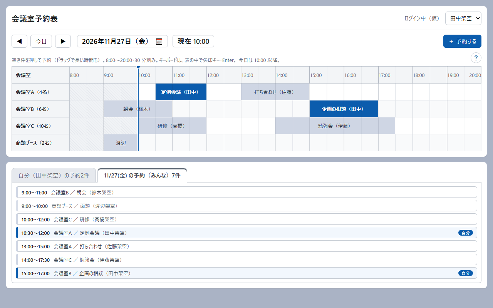
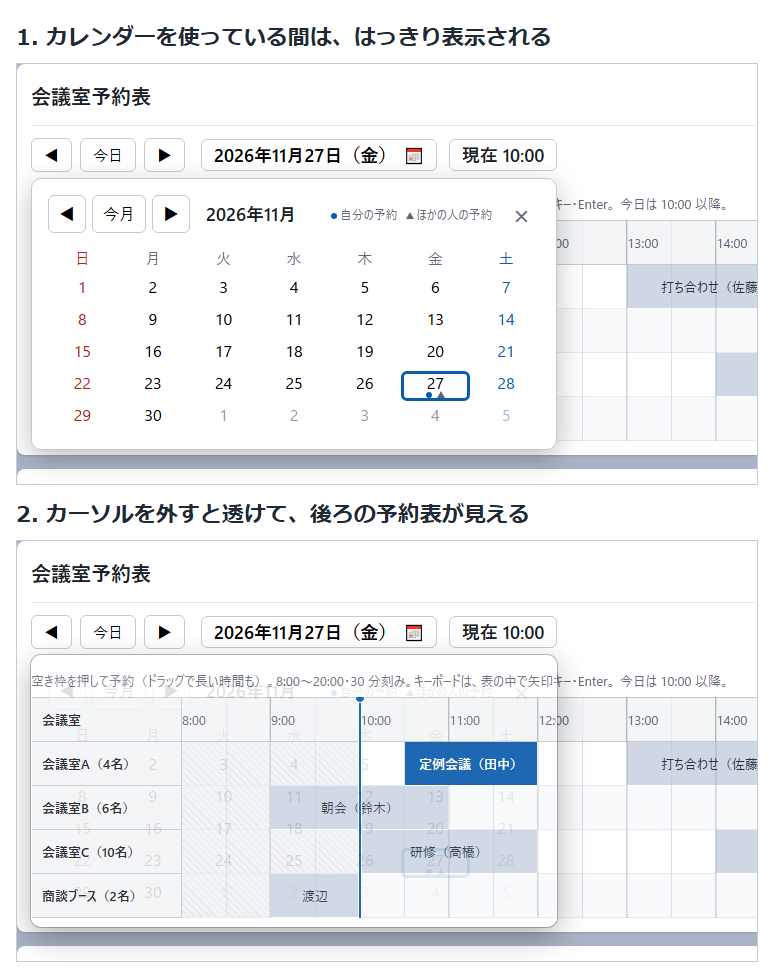

# 会議室予約管理アプリ

## 概要
- **何を作ったか**: 社員が PC で会議室の空きを確認して、予約・変更・キャンセルできる Web アプリです。**予約が重ならないこと**を最優先にしました。
- **自分の役割**: 画面を操作して改善を指示し、公開する内容を決めました（コードは AI が書いています）。
- **こだわり**: [直感的に操作できる、視線をあまり動かさない、間違える前に気づける](#こだわったところ)。
- **学んだこと**: [AI に任せきりにせず、選ぶ理由を自分の言葉で書くこと](#ai-と進めて学んだこと)。

AI（Claude Code）と一緒に作った学習用のアプリで、会社・社員・予約データはすべて架空です。

**技術**: Java / Spring Boot ・ React / TypeScript ・ PostgreSQL

## 自分が担当したこと
- 画面を実際に操作して、直感的な操作と視線の動きの面から、改善を指示しました。
- AI が直した画面や、README の文章と写真を確かめて、公開するかを決めました。
- 足りなかった確認（会議室の状況を聞く項目）を、反省点として整理しました。

コードは AI（Claude Code）が書いています。

## お客様と困りごと（架空）
- **お客様**: 架空ひなたサービス株式会社（オフィス運営・管理業、社員約 6 名、会議室が複数）。
- **困りごと**: 予約を Excel と社内連絡で管理していて、空きの確認に手間がかかり、予約が重なることがある。
- **利用者の例**: 田中架空（35 歳・営業部）。基本的な PC 操作はできるが、複雑なシステムは苦手。
- **作ったもの**: 空き状況の確認、予約、予約の変更とキャンセル。
- **作らなかったもの**: 繰り返し予約、メール通知、管理者画面、本物のログイン。

## こだわったところ
利用者は複雑な操作が苦手で、いちばんの困りごとは予約の重なりです。そこで、次の 3 つを意識しました。変更とキャンセルも、総務部に頼まず自分でできます（取り消しの前には確認を出します）。

### 1. 直感的に操作できる
空いている所を押すだけで、会議室と時間が入った状態で予約できます。長い時間はドラッグで選べます。下の「自分の予約」の一覧では、今日の予約に青い ● が付くので、先の予約と見分けられます。

### 2. 視線をあまり動かさない
予約の表と一覧を近くに置き、同じ画面で見比べられるようにしました。一覧と表は連動するので、どの予約かを探し直さずに済みます。カレンダーは、カーソルを外すと透けて、後ろの表が見えます。

### 3. 間違える前に気づける
同じ会議室の重なりは予約できないようにし、ドラッグの途中で赤く知らせます。自分が同じ時間に別の会議室を押さえようとすると、注意と確認を出します（そういう使い方もありうるので、禁止はしません）。

利用者の立場になって考えると、AI が最初に出した試作より、複雑な操作が苦手な社員にも使いやすい、直感的でシンプルなアプリになったと感じています（これは自分の感想で、実際の利用者には使ってもらっていません）。

## 実装しなかったことと、反省点
利用者の例には「静かな会議室を押さえたい」場面がありましたが、静かな部屋の目印は作りませんでした。

- **判断したこと**: 社員約 6 名・会議室 4 つなら、働くうちに経験で分かると考えました。ただし、入社したばかりの人には分かりません。
- **抜けていたこと**: どの部屋が静かかを、最初にお客様へ確認する項目に挙げていませんでした。
- **次にすること**: 利用者の場面を 1 つずつ要件と照らし合わせ、分からない点を質問として書き出します。

## AI と進めて学んだこと
**よかった点**: 画面を操作して気づいたことを伝えると、直感的な操作や視線の動きの面で、デザインがよくなりました。

**反省点**: 信頼するあまり、AI のおすすめを、理由を考えずに選ぶことがありました。特に文章は、自分の言葉で説明できるかを、もっと慎重に確かめるべきでした。

**これから続けること**
- 選ぶときは、なぜそれがよいと思うかを書く。
- 仕上げのあとに、自分の言葉で説明する練習をする。

## 主な機能
| 機能 | 内容 |
|---|---|
| 社員を選ぶ | 画面の右上で、操作する社員を選ぶ（ログインの代わり） |
| 空きを見る | 日付を選ぶと、会議室 × 時間の表に予約が出る（自分は青、ほかの人はグレー） |
| 予約する | 空いている所を押すかドラッグして、会議室・日付・時間・用件（任意）を確かめる |
| 変更・キャンセル | 自分の、始まる前の予約だけ。どちらも確認が出る |
| キーボード操作 | マウスを使わずに予約できる |

予約は 8:00〜20:00 の 30 分刻み、1 件 4 時間まで、90 日先までです。

## 技術と品質
| 部分 | 使っているもの |
|---|---|
| 画面 | React・TypeScript・Vite |
| API（画面と DB をつなぐ処理） | Java・Spring Boot |
| DB（データの保存） | PostgreSQL |
| テストと自動検査 | JUnit・Vitest・Playwright・GitHub Actions |

- **重なりを二重に防ぐ**: アプリの処理で確かめ、さらにデータベースの決まりでも拒否します。2 人が同時に押した場合は、アプリの確認だけではすり抜けるためです。片方ずつわざと無効にして、テストの結果を確かめました（[確認の記録](docs/completion-check.md)）。
- **自動テスト**: 合計 191 件で確かめています（API 56・画面 126・通しの操作 9）。変更のたびに自動で実行し、成功しないと取り込めない設定です。
- **安全の確認**: パスワードなどが公開されていないか、不正な入力に耐えるかを調べました（[セキュリティ確認](docs/security-review.md)）。
- **進め方**: 作業を登録し、別の場所で作り、自動検査を通してから、人が取り込む順で進めました。

## 詳しい資料
| 資料 | 内容 |
|---|---|
| [要件定義書](docs/requirements.md) | 何を作るかと、その理由（[お客様](docs/client-brief.md)・[利用者の例](docs/persona.md)） |
| [画面設計](docs/screen-design.md)・[データ設計](docs/data-design.md) | 画面と、データの持ち方 |
| [起動方法とテスト](docs/setup.md)・[技術スタック](docs/tech-stack.md) | 動かし方と、使った道具の版 |
| [品質レビュー](docs/quality-review.md) | 直した指摘と、見送った理由 |
| [進捗状況](docs/progress.md) | いつ、何を作り、直したか |
| [CLAUDE.md](CLAUDE.md) | AI に守らせた決まり |

## 注意と制限
- **ログインがない学習用のため、インターネット上に公開して使うことはできません。** 他の社員を選べば、その人の予約も操作できます。
- 対象は PC の Chrome・Edge です。スマートフォン向けには作っていません。
- 弱点を見つけたときの連絡方法は [SECURITY.md](SECURITY.md)。

## ライセンス
[MIT License](LICENSE)
