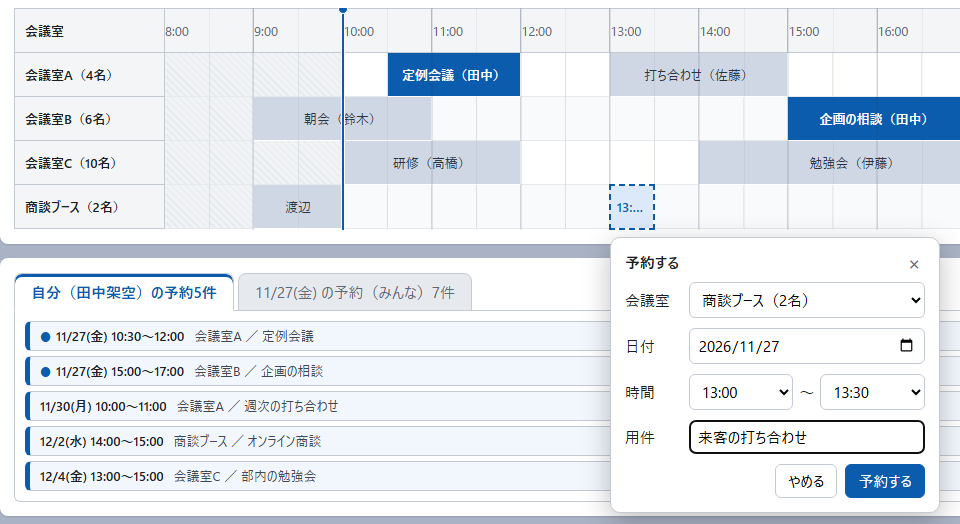
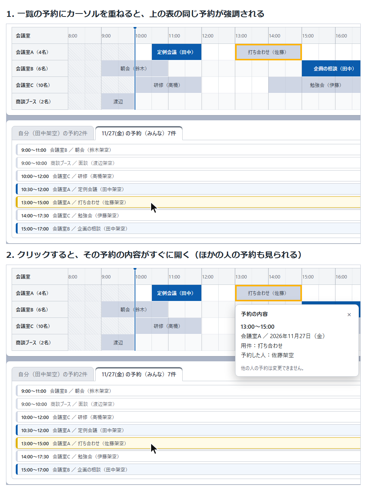
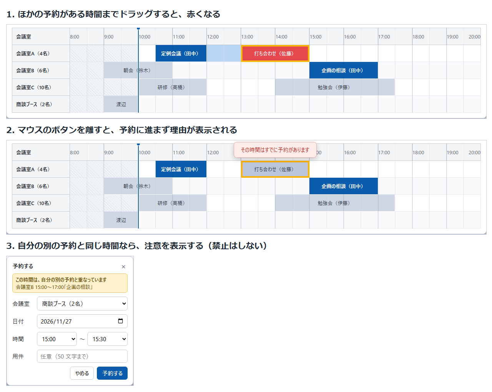

# 会議室予約管理アプリ

社員が PC から会議室の空き状況を確認して、予約・変更・キャンセルできる Web アプリです。**同じ会議室・同じ時間帯の予約が重ならないこと**を、いちばん大事にしています。

AI（Claude Code）を使ったアプリ開発の工程を学ぶための練習用で、会社・社員・予約データはすべて架空です。ログイン機能はなく、自分のパソコンで動かすことを想定しています。

**技術**: Java 25 / Spring Boot ・ React / TypeScript / Vite ・ PostgreSQL

## 目次
- [こだわったところ](#こだわったところ)
- [今回は実装しなかったことと、反省点](#今回は実装しなかったことと反省点)
- [主な機能と使い方](#主な機能と使い方)
- [技術構成](#技術構成)
- [品質と開発の進め方](#品質と開発の進め方)
- [起動方法](#起動方法)
- [クライアントとペルソナ](#クライアントとペルソナ要約架空)
- [注意と制限](#注意と制限)
- [開発の記録](#開発の記録)
- [ライセンス](#ライセンス)

## こだわったところ
写っている社員・予約は、すべて架空のデータです。


お客様は PC の複雑な操作が苦手で、いちばんの困りごとは予約の重複です。そこで、次の 3 つを意識して作りました。変更とキャンセルも、総務部に頼まず自分でできます（取り消しの前には確認を出します）。

### 1. 直感的に操作できる
空き枠を押すだけで、会議室と時間が入った状態で予約できます。長い時間はドラッグで選べます。



### 2. 視線をあまり動かさない
表と下の一覧を離しすぎず、同じ画面で見比べられるようにしました。一覧と表は連動し、どの予約かを探し直さずに済みます。カレンダーは、カーソルを外すと透けて、後ろの表が見えます。




### 3. 間違える前に気づける
同じ会議室の重複は禁止し、ドラッグの途中で赤く知らせます。自分が同じ時間に別の会議室を押さえようとすると、注意と確認を出します（使い方としてありうるので、禁止はしません）。



## 今回は実装しなかったことと、反省点
**静かな会議室の目印**: ペルソナには「静かな会議室を押さえたい」場面がありますが、実装しませんでした。社員約 6 名・会議室 4 つなら、働くうちに経験で分かると判断したためです。ただし、入社したばかりの人には分かりません。

**反省点**: どの部屋が静かかといった会議室の状況を、お客様に確認する項目として、要件の段階で挙げていませんでした。ペルソナの場面に対する疑問を詰めきれず、機能にするかを早い段階で判断できませんでした。次は、ペルソナの場面を 1 つずつ要件と照らし合わせ、分からない点を質問として書き出します（実際に聞けない場合は、仮の答えと理由を決めます）。

## 主な機能と使い方
画面は 1 つだけです（PC 向け）。

| 機能 | 使い方 |
|---|---|
| 社員を選ぶ | 右上の「ログイン中（仮）」で、操作する社員を選ぶ（パスワードなし） |
| 空きを見る | 日付バー（◀ 今日 ▶・カレンダー）で日を選ぶと、会議室 × 時間の表に予約が出る（自分は青、ほかの人はグレー） |
| 予約する | 空き枠を押す（30 分）かドラッグ（長い時間）して、小窓で会議室・日付・時間・用件（任意）を確かめて「予約する」 |
| 予約を見る | 表の枠か、下の一覧のカードを押す。一覧は「自分の予約（今後）」と「その日のみんなの予約」のタブ |
| 変更・キャンセル | 自分の、始まる前の予約だけ。小窓の［変更する］［予約をキャンセルする］か、自分のカードの［変更］［予約をキャンセル］から。どちらも確認が出る |

**予約の決まり**: 8:00〜20:00 の 30 分刻み、1 件は 4 時間まで、今日から 90 日先まで。同じ会議室で時間が重なる予約はできません。自分が同じ時間に別の会議室を予約するときは、注意を出して確認します（禁止はしません）。

**キーボードだけでも予約できます**: 表の中は矢印キーで移動し（Tab で止まるのは表で 1 か所）、Enter で予約の小窓、Shift + ← → で長い時間を選びます。日付の並びの右端の［＋ 予約する］ボタンからは、最初の空き 30 分の小窓が開きます。

## 技術構成
```
ブラウザ ── 画面（React + Vite） :5173
              │ /api を中継
              ▼
            API（Spring Boot）   :8080
              │
              ▼
            DB（PostgreSQL）     :5432（Docker）
```

| 部分 | 使っているもの |
|---|---|
| 画面 | React 19・TypeScript・Vite |
| API | Java 25・Spring Boot・Spring Data JPA・Flyway |
| DB | PostgreSQL 18 |
| テスト | JUnit + Testcontainers（API）・Vitest + Testing Library（画面）・Playwright（E2E） |
| 品質と CI | oxlint・型チェック・SpotBugs・javac の警告・GitHub Actions |

詳しい版は [技術スタック](docs/tech-stack.md)、表と API の設計は [データ設計](docs/data-design.md)。

## 品質と開発の進め方
- **重複予約を二重に防ぐ**: API（Java）で重なりを調べ、さらに DB の排他制約でも拒否します。Java の確認だけだと、2 人が同時に押したときにすり抜けるためです。片方ずつわざと無効にして、テストの結果を確かめました（[完成の目安の見比べ](docs/completion-check.md)）。
- **自動テスト**: API 56 件・画面 126 件・E2E 9 件（2026-11-25 時点）。プルリクエストごとに CI で実行し、成功しないと `main` に入れられません。
- **公開前の確認**: 秘密情報・依存部品・API への不正な入力を調べました（[セキュリティ確認](docs/security-review.md)）。
- **レビューの記録**: 直した指摘と、見送った理由を残しています（[品質レビュー](docs/quality-review.md)）。
- **開発の進め方**: Issue → ブランチ → プルリクエスト → CI → 人がマージ、の順で進めました。AI に守らせる決まりは [CLAUDE.md](CLAUDE.md) にあります。

## 起動方法
必要なもの: Java 25・Node.js 24・Docker。

DB → API → 画面の順に 3 つ起動し、ブラウザで http://localhost:5173 を開きます（ポートは 5432・8080・5173 で固定）。

### 1. DB（PostgreSQL・ポート 5432）
1. `.env.example` をコピーして `.env` を作り、`DB_PASSWORD` を自分で決めた値に書き換える（`.env` は GitHub に載せない）。
2. `docker compose up -d` で起動する（停止は `docker compose down`）。

### 2. API（Spring Boot・ポート 8080）
`backend/` で `./gradlew bootRun`。起動すると、Flyway が表とサンプルデータ（すべて架空）を作ります。

### 3. 画面（React + Vite・ポート 5173）
`frontend/` で、初回だけ `npm ci`、そのあと `npm run dev`。

### テストと検査
| 場所 | コマンド | 内容 |
|---|---|---|
| `backend/` | `./gradlew test` | API のテスト（Docker が必要） |
| `backend/` | `./gradlew check` | テスト + SpotBugs（静的解析）+ javac の警告（Docker が必要。CI と同じ） |
| `frontend/` | `npm run lint` | 書き方チェックと型チェック |
| `frontend/` | `npm test` | 画面のテスト（`npm run coverage` で網羅率） |
| `frontend/` | `npm run build` | 型チェックのあとにビルド |
| `frontend/` | `npm run e2e` | E2E テスト（下の説明を参照） |

E2E テストは、ブラウザを自動で動かして、予約・変更・キャンセルなどを通しで確かめます。先に `docker compose up -d` で DB だけを起動し、**開発用の API・画面は止めておきます**（テストが 8080・5173 で自動起動します）。使い捨ての DB `room_booking_e2e` を作り、終わると消します（開発用の DB は触りません）。初回だけ `npx playwright install chromium` が必要です。

## クライアントとペルソナ（要約・架空）
- **クライアント**: 架空ひなたサービス株式会社（オフィス運営・管理業、社員約 6 名、会議室が複数）。
- **困りごと**: 予約を Excel と社内連絡で管理していて、空き確認に手間がかかり、予約が重複することがある。
- **ペルソナ**: 田中架空（35 歳・営業部）。基本的な PC 操作はできるが、複雑なシステムは苦手。
- **作るもの**: 空き状況の確認、予約、予約の変更、予約のキャンセル。
- **作らないもの**: 繰り返し予約、メール通知、管理者画面、本物のログイン。

詳しくは [要件定義書](docs/requirements.md)・[クライアント情報](docs/client-brief.md)・[ペルソナ](docs/persona.md)。

## 注意と制限
- **インターネット上のサーバーに置かないでください。** ログインがない学習用で、API は `127.0.0.1`（自分のパソコン）だけで待ち受けます。
- **本人の確認はできません。** API は、送られた社員番号をそのまま信じます。変更・キャンセルで予約した人と番号が一致するかは調べますが、他人の番号を送れば操作できます。
- DB のパスワードは `.env` にだけ書きます（コードには初期値も書きません）。
- 対応するブラウザは Chrome・Edge の最新版です。自動テストは Chromium で行っています。
- 弱点を見つけたときの連絡方法は [SECURITY.md](SECURITY.md)。

## 開発の記録
| 文書 | 内容 |
|---|---|
| [進捗状況](docs/progress.md) | いつ、何を作り、直したか |
| [次回の再開メモ](docs/handoff.md) | 今の状態と、次にやること |
| [画面設計](docs/screen-design.md)・[画面モック](docs/mock/index.html) | 画面の要素と、作る前の見本 |

## ライセンス
[MIT License](LICENSE)
