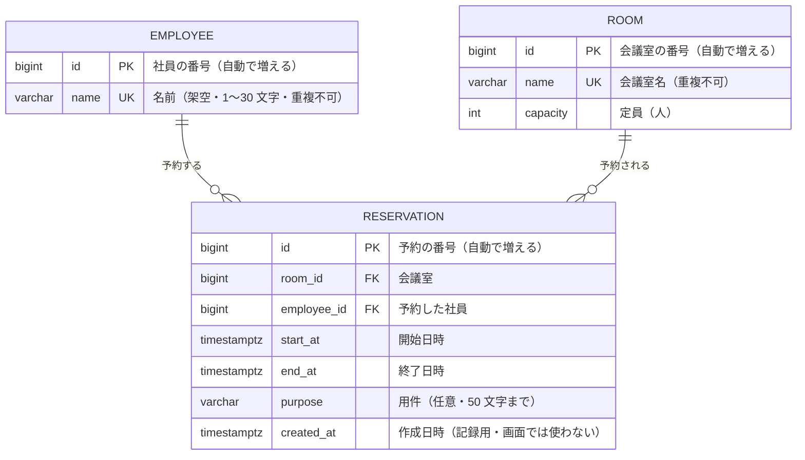

# データ設計（ER 図）

[要件定義書](requirements.md) の「データ」の詳細。**設計案**（まだ作っていない）。

保存するのは「社員」「会議室」「予約」の 3 種類。社員と会議室は DB に最初から入れる（画面からは増減しない）。予約が、社員と会議室を 1 つずつ指す。

## ER 図


GitHub 上では上の図が表示される。表示されない場合は、次の図で見る。

```
 EMPLOYEE（社員）        RESERVATION（予約）         ROOM（会議室）
┌──────────────┐ 1   ┌────────────────────┐   1 ┌──────────────┐
│ id           │──┐  │ id                 │  ┌──│ id           │
│ name         │  └─<│ employee_id        │  │  │ name         │
└──────────────┘  多  │ room_id            │>─┘  │ capacity     │
                      │ start_at / end_at  │ 多  └──────────────┘
                      │ purpose            │
                      │ created_at         │
                      └────────────────────┘
 「1 人の社員が複数の予約を持つ」「1 つの会議室に複数の予約が入る」
```

## 項目の決まり
| 項目 | 決まり |
|---|---|
| 社員 name | 1〜30 文字。重複不可。最初から 6 人の架空の名前を入れる |
| 会議室 name・capacity | 名前は重複不可。定員は 1 以上。最初から 3〜4 室を入れる |
| start_at・end_at | **30 分刻み**（分が 00 か 30、秒は 0）。**開始 < 終了**（同じも不可）。同じ日（日本時間）の中に収める。予約できる時間帯は **8:00〜20:00**。過去の日時では予約・変更できない。**今日から 90 日先まで**。**1 件は 4 時間まで**。始まった予約は変更・キャンセルできない（[要件定義書](requirements.md) の決定事項 8・11〜14） |
| purpose | 任意。前後の空白を除いて 50 文字まで。空なら「（用件なし）」と表示 |
| 日時の扱い | タイムゾーンつきで保存し、画面には日本時間（Asia/Tokyo）で出す |

## DB の約束（テーブル定義でかける制約）
Java のチェックをすり抜けても、DB が最後の砦になるようにする。

| 対象 | 約束 |
|---|---|
| 番号（id） | `bigint GENERATED ALWAYS AS IDENTITY`（自動で増える。手で入れられない） |
| employee.name | NOT NULL・UNIQUE・CHECK（1〜30 文字） |
| room.name / capacity | name は NOT NULL・UNIQUE。capacity は NOT NULL・CHECK（1 以上） |
| reservation の各列 | room_id・employee_id・start_at・end_at は NOT NULL。purpose だけ NULL 可（用件なしは NULL で統一し、空文字は保存しない） |
| purpose | CHECK（50 文字まで） |
| start_at・end_at | CHECK（開始 < 終了、分が 00 か 30、秒は 0）。日本時間は +9 時間ちょうどなので、分は世界のどこから見ても同じ |
| 外部キー | reservation.room_id → room、reservation.employee_id → employee。**削除は禁止**（`ON DELETE RESTRICT`。決定事項 16 のため） |
| 索引（検索を速くする目次） | 「自分の予約」用に `(employee_id, start_at)`。部屋と時間の検索は、排他制約が作る索引で足りる |

- 時間に関わる約束のうち、**過去かどうか・90 日先・8:00〜20:00・同じ日・4 時間まで**は「今の時刻」や日本時間の計算が必要なので、DB には入れず Java で守る。重複だけは DB でも守る。
- 予約のキャンセルは**本当に消す**（記録は残さない）。履歴が必要になったら後で考える。

## 重複の防止（最重視）
同じ会議室で、時間帯が 1 分でも重なる予約は作れない。**二重**で守る。

1. **Java 側のチェック**: 保存の前に、同じ会議室で重なる予約がないかを調べ、あれば分かりやすいメッセージ（409）を返す。
2. **DB 側の制約（PostgreSQL の排他制約）**: Java のチェックをすり抜けても（2 人が同時に押したとき）、DB が重なる保存を拒否する。拒否されたら、Java が 1 と同じ 409 に変えて返す。

```sql
-- 拡張（排他制約で「=」と「重なり」を一緒に使うために必要）
CREATE EXTENSION IF NOT EXISTS btree_gist;

ALTER TABLE reservation ADD CONSTRAINT no_overlap
  EXCLUDE USING gist (
    room_id WITH =,
    tstzrange(start_at, end_at, '[)') WITH &&
  );
```
- `'[)'` は「開始を含み、終了を含まない」。10:00〜11:00 と 11:00〜12:00 は重ならない（続けて予約できる）。
- 開始 < 終了、30 分刻みは、DB の CHECK 制約でも守る（Java のチェックと二重）。
- DB が拒否したときのエラーは、PostgreSQL のエラーコード **23P01**（排他制約違反）で見分けて 409 にする。ほかの DB エラー（例: 23514 = CHECK 違反）は 409 にせず、想定外として 500 にする。
- 予約の**変更**も同じ制約で守られる。変更では自分自身の古い時間とは重ならないので、時間をずらすだけでエラーにならない。Java のチェックでも、自分自身を除いて調べる（モックと同じ）。
- 保存は 1 回の取引（`@Transactional`）の中で行い、DB の拒否を 409 に変えるのは取引の外で行う。
- 排他制約は、Flyway の SQL ファイル（`db/migration`）で作る。

## API（画面と DB の間の窓口）
ログインがないため、操作する社員の番号（employeeId）を画面から送る。本物の認証ではない（学習用）。

| やりたいこと | 方法と宛先 | 送るもの | 返るもの |
|---|---|---|---|
| 社員一覧（F1） | GET /api/employees | なし | 社員の配列 |
| 会議室一覧（F2） | GET /api/rooms | なし | 会議室の配列 |
| 空き状況（F2） | GET /api/reservations?date=2026-11-20 | date（日本時間の日付） | その日の全予約（会議室・社員名・時間・用件） |
| 自分の予約（F4） | GET /api/reservations?employeeId=1 | employeeId | その社員の、今から先の予約（日時の早い順） |
| 予約（F3） | POST /api/reservations | employeeId・roomId・startAt・endAt・purpose | 作った予約 |
| 変更（F4） | PUT /api/reservations/{id} | employeeId・roomId・startAt・endAt・purpose | 直した予約 |
| キャンセル（F5） | DELETE /api/reservations/{id}?employeeId=1 | employeeId | なし |

- 変更・キャンセルは、予約した本人の employeeId のときだけ受け付ける。
- 変更（PUT）の確認の順番: 予約がない 404 → 本人でない 403 → 始まっている 400（「始まった予約は変更できません」）→ 入力の検査 400 → 会議室がない 404 → 自分以外と重なる 409。重なりの確認は自分自身を除く。
- `GET /api/reservations` は date か employeeId の**どちらか 1 つだけ**を付ける。両方・どちらもなしは 400。
- 予約の返す中身は、id・roomId・employeeId・employeeName・startAt・endAt・purpose（画面で社員名を出すため）。
- 日時は ISO 8601 の文字（例: `2026-11-20T10:00:00+09:00`）でやり取りする。
- 入力の検証（30 分刻み・開始 < 終了・時間帯・過去）は、画面と API の両方で行う。

### 失敗したときの返し方
どの API も、失敗は同じ形で返す。

| 状況 | 状態コード | 返す中身（JSON） |
|---|---|---|
| 入力が正しくない（30 分刻みでない・終了が開始以前・時間帯の外・過去・90 日より先・4 時間超・始まった予約の変更・用件が長すぎる・壊れた JSON など） | 400 | `{"message": "終了は開始より後にしてください"}` のように、原因が分かる 1 文 |
| 他の人の予約を変更・キャンセルしようとした | 403 | `{"message": "ほかの人の予約は変更できません"}` |
| 予約・社員・会議室が見つからない | 404 | `{"message": "予約が見つかりません"}` |
| 同じ会議室の同じ時間帯にすでに予約がある | 409 | `{"message": "その時間はすでに予約があります"}` |
| 想定外のエラー | 500 | `{"message": "エラーが起きました"}`（内部の詳細は返さない） |

- 成功の状態コードは、取得・変更が 200、予約が 201、キャンセルが 204。
- 画面は、失敗したときにメッセージを表示し、入力した内容を消さない。
- DB への問い合わせは、文字を直接つなげず、パラメータで渡す（SQL インジェクション対策）。

## 今回は持たないデータ
繰り返しの規則・参加者・通知・管理者・パスワードは持たない（[要件定義書](requirements.md) の「対象外」を参照）。

## サンプルデータ（架空）
- 社員: 田中架空、佐藤架空、鈴木架空、高橋架空、伊藤架空、渡辺架空
- 会議室: 会議室A（4 名）、会議室B（6 名）、会議室C（10 名）、商談ブース（2 名）
- 用件の例: 「営業定例」「架空商事 オンライン商談」
